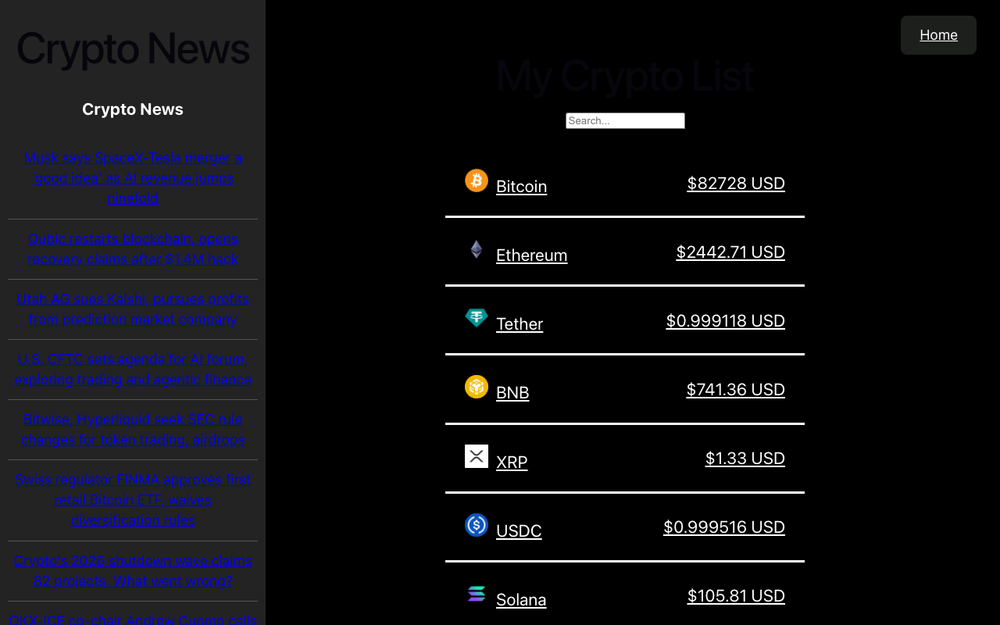
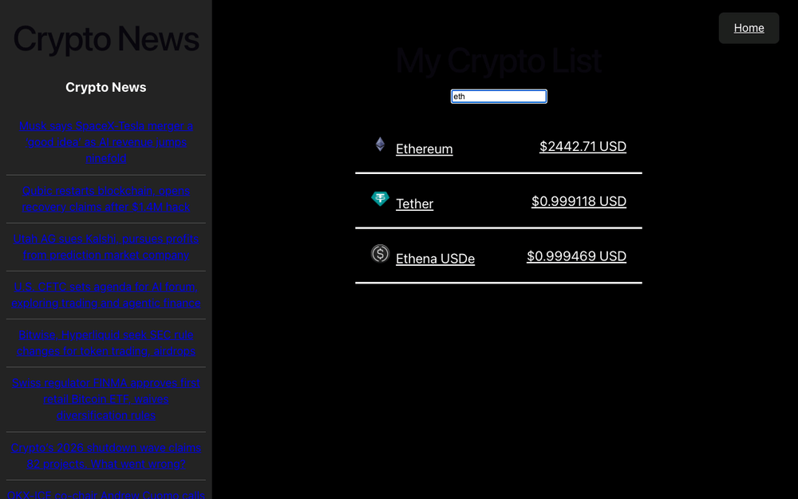
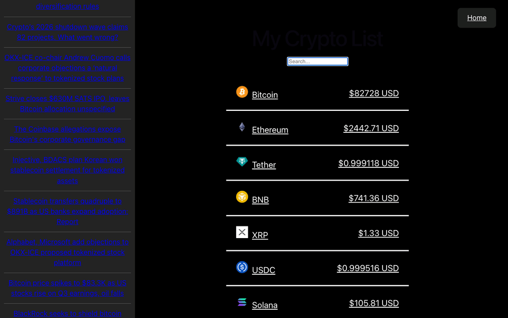
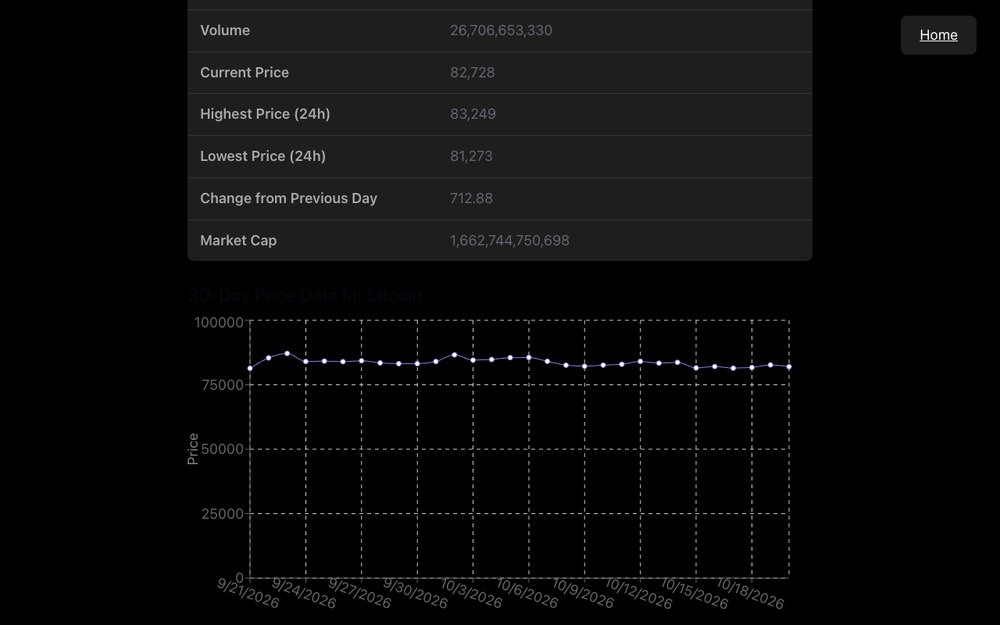
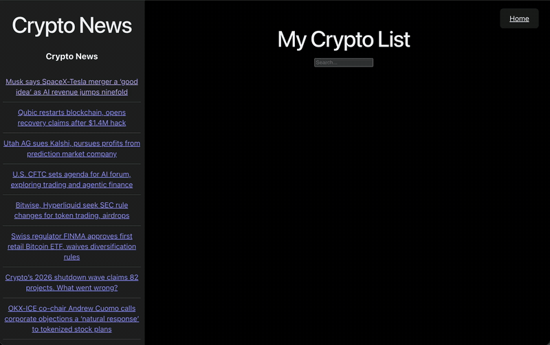

# Crypto Hustle Pro ₿ 🪙

A React app that lists the top 30 cryptocurrencies by market cap, with live prices from the [CoinGecko API](https://www.coingecko.com/en/api). Search the list, open any coin for details and a 30-day price chart, and read the latest crypto headlines.

## Features

- Fetches the top 30 coins by market cap (USD) from CoinGecko
- Shows each coin's icon, name and current price
- Search box that filters by coin name or symbol
- Coin detail page with description, links, supply, volume and 24h price stats
- 30-day price chart for each coin
- Crypto news sidebar with the latest headlines from Finnhub
- Client-side routing, with a "page not found" screen for bad URLs

## Tech Stack

- [React](https://react.dev/) 19
- [Vite](https://vite.dev/)
- [React Router](https://reactrouter.com/) 8
- [Recharts](https://recharts.org/) 3
- [CoinGecko API](https://www.coingecko.com/en/api) for prices and coin data
- [Finnhub API](https://finnhub.io/) for crypto news

## Screenshots

| Whole page | Search | News |
| --- | --- | --- |
|  |  |  |

| Coin detail | Coin chart | Page not found |
| --- | --- | --- |
|  |  |  |

## Video Walkthrough

A short walkthrough of the app: the coin list with the news sidebar, a coin's details and price chart, and the page-not-found screen.



## Getting Started

### Prerequisites

- [Node.js](https://nodejs.org/) and npm
- A free CoinGecko Demo API key ([get one here](https://www.coingecko.com/en/api))
- A free Finnhub API key ([get one here](https://finnhub.io/register))

### Installation

```bash
git clone https://github.com/mdoran3/crypto-hustle.git
cd crypto-hustle
npm install
```

### Environment variables

Create a `.env.local` file in the project root (it is git-ignored):

```
VITE_APP_API_KEY=your_coingecko_demo_api_key
VITE_NEWS_API_KEY=your_finnhub_api_key
```

Restart the dev server after changing it. Vite only reads env files at startup.

### Run

```bash
npm run dev
```

Then open the URL Vite prints (usually http://localhost:5173).

## Scripts

| Command | Description |
| --- | --- |
| `npm run dev` | Start the dev server |
| `npm run build` | Build for production |
| `npm run preview` | Preview the production build |
| `npm run lint` | Run ESLint |

## Note on the API key

Vite inlines `VITE_*` variables into the built JavaScript, so the key is visible in the browser once deployed. This is fine for free CoinGecko and Finnhub keys, but don't use this pattern for sensitive keys.
